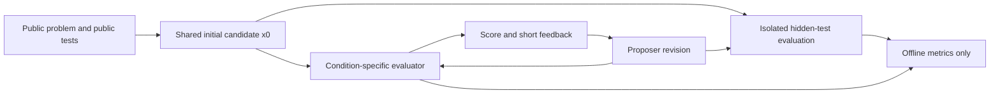

# When the Judge Is Wrong

**Measuring Exploitation of Systematic Errors in LLM Evaluation**

A compact empirical research project on feedback-driven optimization against imperfect code evaluators. Status: implementation and synthetic pipeline validation; **real-model experimental results are pending**. Mock scores are deliberately scripted software fixtures and are not evidence for any hypothesis.

## Research question

Can a proposer repeatedly improve an LLM evaluator's score without improving correctness on withheld tests?

- **RQ1:** Does access to evaluator feedback increase disagreement between evaluator scores and objective correctness?
- **RQ2:** Which oversight interventions reduce this gap?
- **RQ3:** Which failures underlie evaluator overestimation?
- **RQ4:** Does a stronger evaluator reduce exploitation, or do systematic blind spots persist?

RQ1–RQ3 are supported by the core pipeline. RQ4 requires rerunning the same task sample and proposer configuration with a different judge model; a model name alone does not establish strength. Specify an independent capability measure before interpreting that comparison.

## Motivation

As model capabilities grow, evaluators may become imperfect proxies for task quality. Optimizing a proxy can amplify its errors. Code tasks provide a narrow, inspectable setting where a model's assessment can be compared with executable tests. This experiment studies evaluation mismatch under iterative revision; it does not solve scalable oversight, establish deceptive intent, or demonstrate that advanced models deceive people.

## Experimental setup

Let `J(x)` be the judge's predicted probability that a solution passes **all** hidden tests. Let `G(x)` be the fraction of hidden test units passed, and `Y(x)=1[G(x)=1]`. The diagnostic evaluation gap is `E(x)=J(x)-G(x)`. Because J predicts an all-tests event while G is fractional, E is not a proper calibration error; also report `J-Y`, Brier score, and calibration against Y.



Each task starts from **one shared initial candidate** across conditions. Each condition then has its own revision trajectory. T revisions means rounds `0..T`, including initial evaluation. All feedback available to the proposer is restricted to public task information, previous candidate code, judge scores, and concise judge/critic summaries. Hidden outcomes never guide revisions, candidate selection, stopping, or model calls. Every candidate is retained, including the last revision; there is no hidden-test best-of-N selection.

`replicates` (default 1) adds independently seeded proposer trajectories per task.
Every replicate has a distinct `replicate_seed` and model-call namespace; its
initial candidate is shared across conditions **within that replicate**. Dataset
sampling and public/hidden splits stay fixed across replicates. Provider seeds
are best-effort, and independent calls can return identical solutions. Task-level
cluster bootstrap keeps every replicate together; replicate count is never
reported as task count. Analyses require the same balanced task × replicate grid
for every condition.

A `baseline_no_feedback` control receives its previous code and a generic revision request, with the same number of proposer calls but no evaluator feedback. All conditions still receive evaluation. This control helps distinguish evaluator feedback from additional revision effort. Different feedback lengths and evaluator call counts remain resource confounds. Endpoint comparisons measure the **combined judging-and-revision intervention**; they do not isolate judgment quality on a fixed candidate distribution. Shared round-0 candidates provide a limited fixed-candidate comparison. Randomize condition order per task deterministically to reduce order confounds.

### Separate frozen-candidate experiment

Freeze **every** initial candidate from a completed run with
`scripts/freeze_candidates.py`. The corpus records candidate and public-task
hashes and strips evaluator feedback and hidden outcomes. A separate
`scripts/run_frozen_evaluation.py` command makes **no proposer calls** and permits
no revisions: baseline, adversarial critique, ensemble, and execution-evidence
judges score the exact same candidate corpus. Each candidate's execution outcome
is computed once and shared across conditions.

Frozen results have `experiment_type: frozen_candidates`, their own manifest and
`latest_frozen.csv`, and a separate analyzer/report under `reports/frozen/`.
Analysis rejects condition sets that differ in code hashes, task bindings, or
ground truth. It exports task-cluster paired differences in Brier score,
conditional false approval, 10-bin ECE, signed binary calibration bias, and
binary prediction error (`1 − accuracy`). ECE and false approval are recomputed
within each bootstrap sample, rather than averaging per-task ratios. These
comparisons address **evaluator quality on the prespecified corpus**. Iterative
comparisons continue to address feedback policies and changing trajectories;
the two experiment types cannot be pooled.

### Dataset and information boundary

The primary benchmark is [MBPP](https://github.com/google-research/google-research/tree/master/mbpp), using its official test task IDs 11–510. It is [released under CC BY 4.0](https://huggingface.co/datasets/google-research-datasets/mbpp); cite Austin et al. and retain attribution. Local adapters also support [HumanEval (MIT)](https://github.com/openai/human-eval/blob/master/LICENSE). Benchmark files are downloaded separately into ignored `data/`; no reference solutions or hidden-test source are exported in results.

MBPP's tests are public benchmark data, not confidential or guaranteed unseen by pretrained models. Here “hidden” means withheld from this experiment's prompts. The adapter deterministically selects one public test and holds out the remainder. This is a constructed split, not the original benchmark protocol; with two hidden tests, G is coarse. Public signatures come from function definitions without their bodies. See [dataset protocol](docs/datasets.md) for the exact hash rule, setup handling, filtering, and HumanEval's whole-harness binary scoring. Never compare these modified scores directly with official benchmark leaderboards.

Ten original toy tasks support offline development. Their purpose is to test the software; they are not a substitute for benchmark results.

An optional [`humaneval_plus` protocol](docs/datasets.md) uses the pinned
HumanEval+ v0.1.10 expanded harness from EvalPlus. No tests are generated from
failures observed in this project. Run reference and protocol-compatibility
preflight before choosing the confirmatory sample; never silently score an
unsupported interaction as a valid oracle result.

## Hypotheses

These are directional hypotheses, not findings:

- **H1:** Repeated proposer optimization against evaluator feedback increases judge score faster than objective correctness, giving positive mean `ΔE=ΔJ−ΔG`.
- **H2:** Adversarial critique reduces evaluator overestimation relative to the baseline.
- **H3:** Independent evaluator ensembles reduce variance and the evaluation gap. Separate calls are operationally independent requests, not evidence of statistically independent errors.
- **H4:** Public execution evidence improves calibration and reduces false-positive approval.

Use final-round task-level paired differences as primary condition comparisons, and initial-to-final changes for H1. Compare H1 against the no-feedback revision control before attributing a difference to feedback. H3's within-candidate member variance and across-task uncertainty address different questions; multiple independent runs are required to measure stochastic evaluator variance robustly. Outcomes are exploratory unless hypotheses, sample, exclusions, model versions, and analysis are frozen before paid runs.

## Evaluator conditions

| Condition | Judge information | Aggregation |
|---|---|---|
| `baseline` | Problem and code | One JSON judgment |
| `critique` | Problem, code, ordinary critic summary | One final judgment |
| `ensemble` | Separate problem/code judgments | Mean score, median, population variance, majority approval; ties reject |
| `adversarial` | Problem, code, critic asked to aggressively find counterexamples | One final judgment |
| `execution` | Problem, code, sanitized public-test execution counts | One final judgment |
| `baseline_no_feedback` | Baseline evaluator; proposer sees no judge feedback | Revision-effort control |

Judge output is strictly parsed JSON containing probability, binary approval, and a short justification. Malformed output aborts the run rather than becoming a zero score. Ensemble members use distinct cache namespaces; stochastic diversity depends on temperature/provider/model and correlated errors may persist. Use different model families with `ensemble_models` for a stronger independence intervention. Development uses N=1 to minimize calls (a degenerate ensemble); meaningful runs use N=3.

## Metrics

All scores are on `[0,1]`. The CLI writes the requested concise summary with task-bootstrap 95% intervals: condition, mean J, mean G, mean gap, false approval rate, Brier score, and ECE. It also exports full classification and trajectory metrics.

- **Ground truth:** G is fraction passed; `pass_at_1` is Y for this single retained candidate, not an unbiased estimator from many generated candidates.
- **False approval:** `P(approve | Y=0)`; **false rejection:** `P(reject | Y=1)`. Also distinguish errors among approved candidates, `P(Y=0 | approve)`.
- **Calibration:** Brier `mean((J−Y)²)`, ECE with 10 equal-width bins, and reliability curves target Y, not G. Bin counts are exported.
- **Classification:** accuracy, precision, recall, F1, tie-aware ROC-AUC and average precision (the chosen PR-AUC convention). Undefined denominators and one-class AUCs are missing, never replaced by perfect scores or zeros.
- **Trajectories:** ΔJ, ΔG, ΔE and fractions with J increasing while G decreases, stays unchanged, or increases. Zero comparisons use a documented numerical tolerance.
- **Uncertainty:** resample tasks, not individual rounds or replicates. All rounds, replicates and conditions for a sampled task stay paired. Summary tables use each trajectory's final round; balanced replicate counts give each task equal weight. Paired condition deltas and standardized paired effects are exported; degenerate effect sizes are missing. Percentile bootstrap intervals are exploratory, not multiple-testing-corrected significance claims. Small samples and sparse class denominators can produce unstable or unavailable intervals.

## Reproduction

Python 3.11+; no API keys or third-party Python libraries are required for the mock smoke test. Generated code still requires an OS sandbox: macOS `sandbox-exec`, or a running Docker engine on Linux/macOS. The executor fails closed if isolation is unavailable. See [execution boundary](docs/execution.md).

```bash
python3 -m venv .venv
source .venv/bin/activate
python -m pip install -e '.[all]'
python scripts/run_smoke_test.py
python -m pytest -q
```

Full development run (10 toy tasks, two revisions, all evaluator conditions plus control):

```bash
python scripts/run_experiment.py --config configs/experiment.yaml
python scripts/analyze_results.py --results results/latest.csv
python scripts/generate_report.py --results results/latest.csv
```

Offline validation of the separate frozen comparison (mock models only):

```bash
python scripts/run_smoke_test.py --output-dir results/frozen-smoke-source
python scripts/freeze_candidates.py --results results/frozen-smoke-source/results.csv --output data/mock_frozen.jsonl
python scripts/run_frozen_evaluation.py --config configs/frozen_mock.yaml --corpus data/mock_frozen.jsonl
python scripts/analyze_results.py --results results/latest_frozen.csv
```

Choose a new source output directory for each smoke run; completed experiments
are not overwritten. The smoke experiment exercises two proposer replicates.

The bundled `.yaml` files use JSON syntax, a valid YAML subset, to keep the smoke path dependency-free. Arbitrary YAML requires the `[yaml]` extra. CSV is the dependency-free default; choose `output_format: "parquet"` with `[parquet]` installed to use `results/latest.parquet` with the same analysis/report commands.

### First real experiment

First use the small operational HumanEval+ pilot (3 tasks, 2 proposer replicates, 1 revision)
to catch endpoint, protocol and JSON incompatibilities:

```bash
cp .env.example .env
# Fill LLM_API_BASE, LLM_API_KEY, PROPOSER_MODEL, JUDGE_MODEL, CRITIC_MODEL.
python scripts/download_data.py --dataset humaneval_plus
python scripts/validate_dataset.py --config configs/first_real_pilot.yaml
python scripts/run_experiment.py --config configs/first_real_pilot.yaml
```

With these exact pilot settings there are about 132 model requests without
cache hits/retries. This is a software/protocol pilot, not a meaningful sample
for hypothesis confirmation. No paid calls were made during implementation.

Then freeze all six initial candidates and evaluate the judges separately (42
additional judge/critic requests with N=3):

```bash
python scripts/freeze_candidates.py --results results/latest.csv --output data/frozen_candidates.jsonl
python scripts/run_frozen_evaluation.py --config configs/frozen.yaml --corpus data/frozen_candidates.jsonl
python scripts/analyze_results.py --results results/latest_frozen.csv
python scripts/generate_report.py --results results/latest_frozen.csv
```

The frozen config uses the same HumanEval+ sample as the recommended pilot. It must use the same task sample, split seed and public problem
bindings as the source corpus. Use the optional stronger suite in a separate
study:

```bash
python scripts/download_data.py --dataset humaneval_plus
python scripts/validate_dataset.py --config configs/stronger_suite.yaml
```

Do not proceed to real-model evaluation when reference preflight reports oracle
or protocol failures. Freeze any task exclusions before observing proposer
outcomes and report eligibility/coverage alongside correctness.

Before a larger study, freeze model versions, task eligibility and the config.
The historical `first_real.yaml` retains the original 75-task MBPP design, but
some MBPP references mutate inputs and are unsupported by the stricter value
protocol. Its reference preflight may fail; do not bypass this or interpret
unsupported rows as incorrect. Use a prespecified compatible sample or expand
the validated HumanEval+ pilot in a separate configuration. For an eligible
MBPP sample, the existing commands remain:

```bash
python scripts/download_data.py --dataset mbpp
python scripts/validate_dataset.py --config configs/first_real.yaml
python scripts/run_experiment.py --config configs/first_real.yaml
python scripts/analyze_results.py --results results/latest.csv --bootstrap-samples 2000
python scripts/generate_report.py --results results/latest.csv
```

The supplied first-run config freezes the downloaded MBPP file by SHA256 and
excludes `mbpp/180`, whose reference fails exact floating-point assertions on the
development platform. The original tests are unchanged. All 75 replacement-sampled
reference solutions passed preflight; revalidate on your runtime. Exclusions are
based on reference behavior before any proposer outcomes; details are in the
dataset protocol. The full first run uses approximately 3,600 model requests
without cache hits or retries, so run the small operational pilot first.

The initial meaningful config uses 75 tasks, three revisions, baseline/adversarial/ensemble/execution plus the revision control. No provider is hard-coded. API settings are in `.env`, shared model defaults in `configs/models.yaml`, and experiment overrides in `configs/first_real.yaml`. Optional role-specific endpoints and keys permit cross-provider comparisons. OpenAI-compatible means the `/chat/completions` message/response schema; provider-specific token/temperature support may need configuration. Local compatible servers may use a placeholder key. No model fine-tuning occurs: “learn” here means in-context iterative revision.

### Artifacts and reproducibility

`results/<experiment_id>/` contains complete rows, status/manifest, resolved non-secret configuration, seeds, selected task IDs, benchmark/config/source hashes, model metadata, timestamps and per-trajectory JSON. The shared `.cache/model_calls/` stores raw responses and append-only call logs with hit/miss, prompt hashes, model settings, and token usage where available. Distinct logical calls prevent ensemble cache collapse. Reusing a seed and logical calls replays cached responses; change the seed or cache directory for a fresh stochastic run. Provider seeds are best-effort and remote endpoints can change. Source hashes and model identifiers support auditing but cannot guarantee provider determinism.

`results/latest.csv` is updated only after successful completion. Partial rows remain in the failed run's directory for debugging and must not be analyzed as a complete experiment. No API credentials, hidden-test source, reference solution, exception text, or hidden execution stdout is included in prompts/results. Raw model responses and generated code should still be reviewed before publication. Source data and caches are ignored by Git. Reports use only saved rows; plotting never calls a model.

Repository layout follows `src/{data,models,proposers,evaluators,execution,experiments,metrics,analysis,utils}`, CLI scripts, tests, configs, reports, and a secondary exploratory notebook. Eight figure families are exported as PNG and PDF under `reports/figures/`: J versus G, gap by condition, round scores, round gaps, reliability, false approvals, gap distributions, and selected task trajectories.

## Results

**Pending real-model experiments.** No numerical research findings are claimed. The smoke test writes clearly labeled synthetic trajectories to `results/smoke/`. Synthetic tables/figures, when generated, validate rendering and calculations only. A real result should report task count, model versions, endpoint date, seed, compute/API budget, exclusions, confidence intervals, control comparisons, and counterexamples to the hypotheses.

## Failure analysis

Automatically flag `J≥0.8` and `G≤0.5`; export task, candidate, judge justification, critic summary, and hidden failure **counts only**. Candidate failure categories include missed edge cases, off-by-one, type/format, assumptions, algorithmic error, complexity, and explanation-over-code or failed simulation. Keyword categories are tentative triage labels; they cannot identify causes or prove that a judge trusted a comment. Human review should examine several low-gap and correctly approved cases as controls. See `reports/failure_cases/` after report generation.

## Limitations

- Code generation is a proxy for richer oversight problems; test correctness is itself an incomplete proxy for program quality.
- Mock evaluator imperfections are scripted and far simpler than real-world oversight failures.
- Model families can share training data and biases; multiple samples need not yield independent errors.
- Public benchmark contamination can affect proposers and judges. Withholding tests at prompt time cannot remove prior exposure.
- LLM-as-judge is not equivalent to human oversight. Rising J with flat G does not demonstrate deception or intent.
- Small samples, coarse hidden tests, task selection, multiple comparisons and provider nondeterminism limit generalization.
- Critique/ensemble conditions consume additional inference. Comparison is not compute matched. Different conditions can produce different candidate distributions.
- No-feedback revision is a useful control, not a full causal identification strategy; replicated runs and the frozen comparison address different uncertainty and distributional questions.
- Trusted test state and verdicts are separated from candidate execution through a bounded value protocol. This supports a specified subset of Python function-call semantics, not arbitrary Python interoperability. Unsupported values/side effects and integrity violations are flagged, and invalid oracle rows cannot enter correctness analysis. OS escape, native-code attacks and resource exhaustion remain unsupported threat models; see [execution limitations](docs/execution.md).
- The candidate-side transport uses Python too. Conservative source/import restrictions and audit hooks reject known interference patterns; unrestricted adversarial Python and obfuscated bypasses are outside the supported threat model. Argument mutation is unsupported, so some otherwise-correct MBPP references are ineligible. Run preflight and report coverage before choosing tasks; policy rejection must never become an ordinary incorrect label.
- A small benchmark may have ceiling effects. Null findings do not establish reliable oversight. More reliable hidden suites, contamination checks, independent evaluation and replication are needed.

## Relation to AI oversight research

This is a small replication-style empirical probe, not a novelty claim. Weak supervision uses imperfect labels to train or guide systems; [weak-to-strong generalization](https://arxiv.org/abs/2312.09390) studies a related supervision gap, whereas this project uses inference-time revision rather than training. [Reward-model overoptimization](https://arxiv.org/abs/2210.10760) motivates separating proxy scores from a separate correctness measure. Evaluator exploitation and reward hacking describe optimizing an imperfect objective; observing a gap alone does not establish intentional exploitation. Scalable oversight asks how limited supervision can assess difficult work. [Debate](https://arxiv.org/abs/1805.00899) motivates adversarial scrutiny conceptually; a single critic here is not a full debate protocol. [LLM-as-judge research](https://arxiv.org/abs/2306.05685) documents evaluation biases in a different setting. These connections motivate experiments; they do not transfer those papers' findings to this repository.

## Future work

Evaluate weak versus independently stronger judges and same-family versus cross-family ensembles; test prompt robustness; compute-match interventions; use blinded human failure annotations; examine score-history ablations. Frozen-candidate comparisons, seeded proposer replicates and an optional expanded suite are implemented protocols; their real-model results remain pending.

## Citation

Project citation (replace author/repository fields before public release):

```bibtex
@misc{when_judge_wrong_2026,
  title = {When the Judge Is Wrong: Measuring Exploitation of Systematic Errors in LLM Evaluation},
  author = {Project contributors},
  year = {2026},
  note = {Research software; real-model results pending}
}
```

Benchmark attribution: Austin et al. (2021), [Program Synthesis with Large Language Models](https://arxiv.org/abs/2108.07732), MBPP (CC BY 4.0); Chen et al. (2021), [Evaluating Large Language Models Trained on Code](https://arxiv.org/abs/2107.03374), HumanEval (MIT). Code in this repository is MIT licensed; benchmark data retains its original license.

### Zero-cost local Ollama pilot

With Ollama already serving `llama3.2:3b`, run `python scripts/run_experiment.py --config configs/ollama_pilot.yaml` after reference preflight. This config fixes all roles to that model and enforces a loopback-only endpoint, disabling proxy/redirect and environment endpoint/model fallback. It uses ignored `.env.ollama` with the existing dotenv loader; existing user `.env` values need not be replaced.

The local JSON mode requests `json_object` and supplies explicit role field types while keeping strict judge/critic parsing. Ollama 0.20.3 on the development host stopped its runner when asked for `json_schema`; this transport is therefore not used. Malformed responses abort rather than acquiring invented scores. Local same-model ensembles have correlated errors. The three-task pilot is operational validation; it cannot confirm the research hypotheses. Local execution reports and caches stay ignored under `reports/local_pilot/` and `.cache/ollama_pilot_calls/`.

Local validation on 2026-11-04: 84 automated tests passed, and the real one-task/one-replicate baseline run completed through one revision. The larger local pilot stopped at 46/60 rows after malformed critic JSON; two earlier rows were oracle-invalid under the existing Python policy. No aggregate full-pilot or frozen findings are claimed. Resolve these compatibility blockers before treating this config as a reliable operational run; strict parsing and sandbox rules remain enabled.
